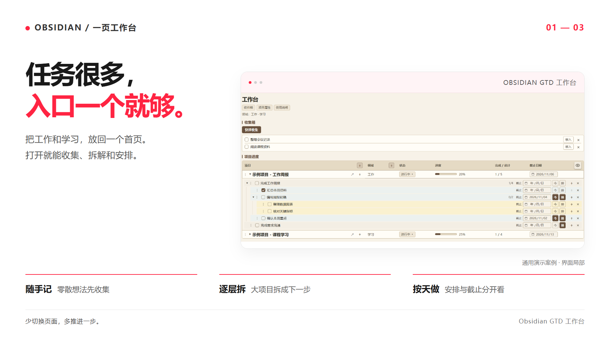
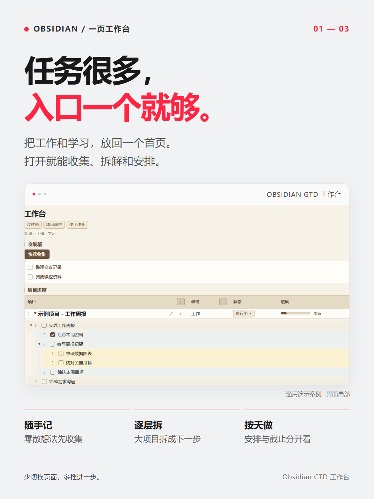
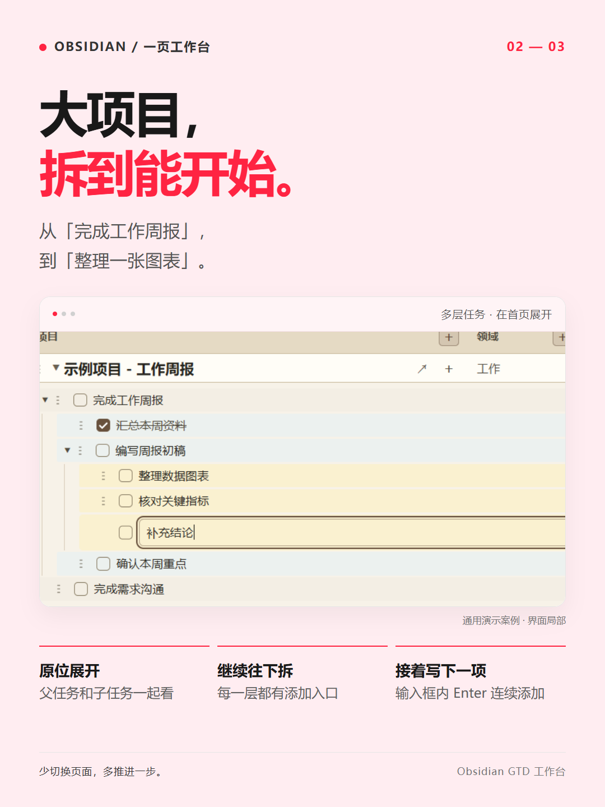
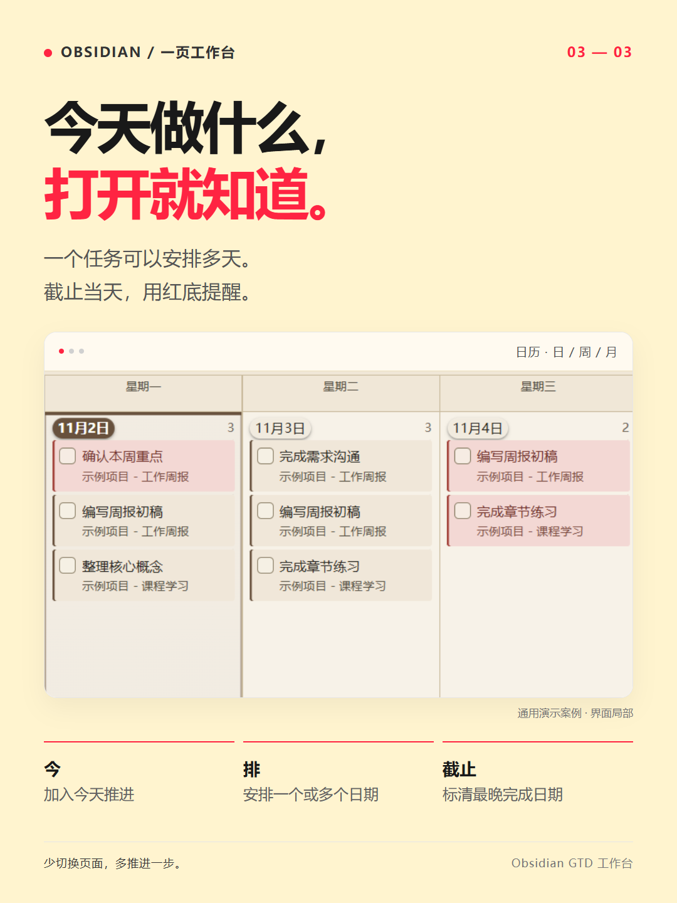

# Obsidian GTD 工作台

**把工作和学习，放回一个首页。**

待办记了一堆，**今天先做哪件？**

项目建好了，**下一步怎么开始？**

一件事要做好几天，**每天都要重新记吗？**

这个工作台把收集箱、项目进度和日历放在一起，让你打开首页，就能继续推进。

## 日常只关注三件事

📥 **先收集。** 零散想法随手记，理清后移入项目。

🧩 **拆到能做。** 父任务、子任务逐层展开，在原位添加、改名、勾选。

🗓️ **安排到天。**「今」加入今天，「排」可以选择多天，「截止」标清期限。同一任务安排多天，仍然只有一条源任务。

  
  
  

父任务的日期会补给尚未设置的子任务；已有日期保持独立。全部子任务完成后，才能勾选父任务；取消子任务的完成状态，所有上级自动恢复为未完成。

父任务旁的数量只看直接子任务，项目进度按末级任务计算；日历只显示末级任务，让每天的安排聚焦具体行动。

日视图可切换“路径／分组”，当天任务与逾期任务同步显示归属；分组按项目和父任务逐层合并、折叠，顺序跟随项目进度。悬停查看完整父级路径，点击路径直接定位任务。

需要安静一点？眼睛按钮可以收起已完成任务；结束的项目可以完成或归档。误操作用 **Ctrl+Z** 撤销。

## 打开就开始

1. 安装 [Obsidian](https://obsidian.md/download) **1.13.1 或更高版本**。
2. 下载并解压本仓库，在 Obsidian 中把同时含有 `00 GTD` 和 `.obsidian` 的文件夹**作为仓库打开**，允许使用社区插件。
3. 打开 **`00 GTD/首页.md`**，使用阅读模式或实时预览，从自带示例开始。

**四个必需插件和 CSS 已包含。** Dataview、Tasks、Tasks Calendar、GTD 快捷操作已随包提供。可选 WebDAV 同步插件也已附带，启用后填写自己的账号。

[安装与图解教程](docs/安装与使用.md) · [完整使用说明](00%20GTD/使用说明.md)

已有 Obsidian 库？

按[合并说明](docs/安装与使用.md#5-合并到已有库)复制工作台、插件和 CSS，保留自己原来的插件设置与仓库配置。

版本 **1.13.4** · 更新于 **2026-11-10** · 配图均为通用演示案例

[第三方插件来源与许可](THIRD-PARTY-NOTICES.md)
