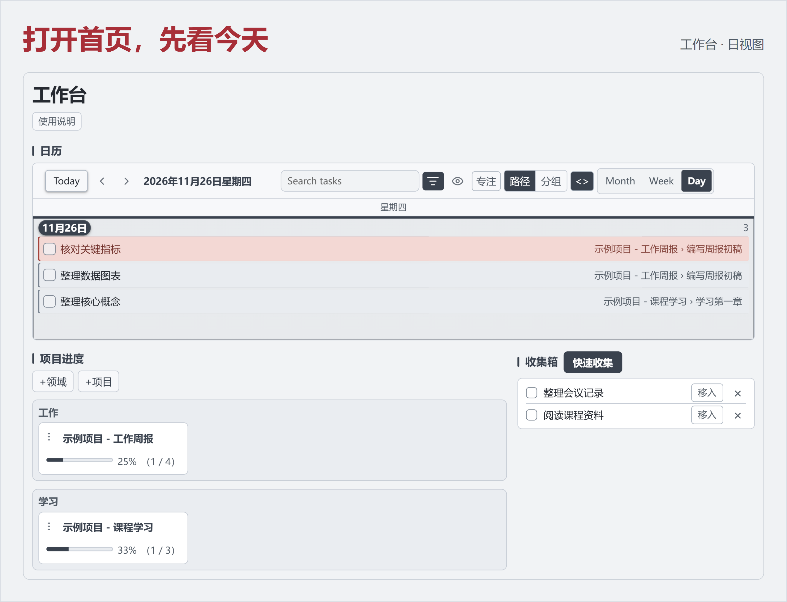
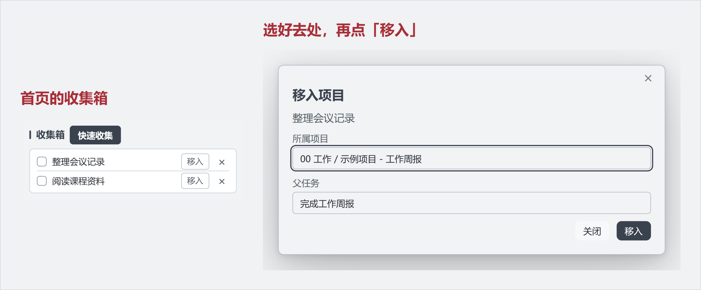
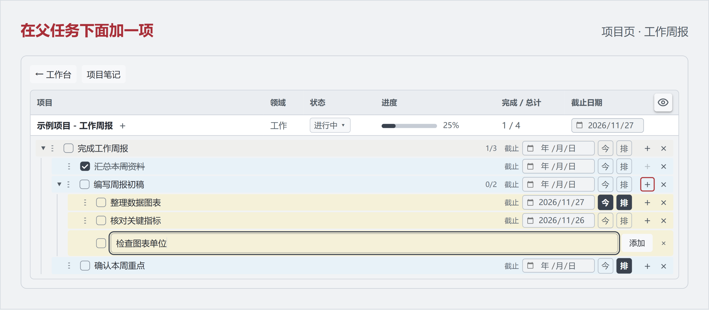
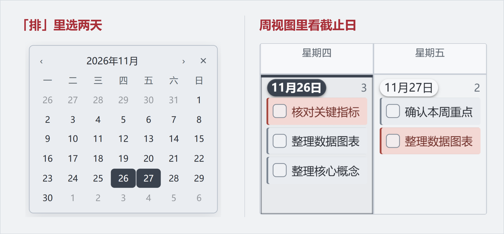
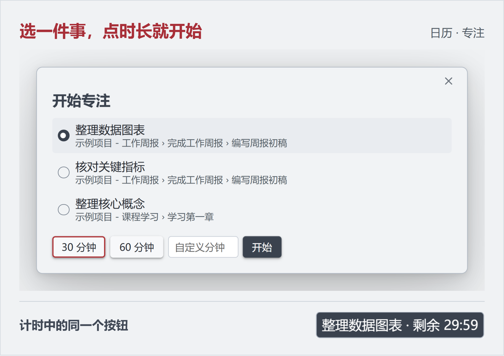

# Obsidian GTD 工作台

打开首页，日历里是今天要做的事，下面是按领域分好的项目和随手记事的收集箱。点进一个项目，才展开它的任务清单。项目和任务都保存在 Obsidian 库的 Markdown 笔记里。

[下载工作台 ZIP](https://github.com/QiminW/Obsidian_GTD_System/archive/refs/heads/main.zip) · [第一次打开](#第一次打开) · [图解与快捷键](00%20GTD/使用说明.md)

*下面用演示项目「工作周报」走一遍。点图可放大查看按钮。*

## 临时想到一件事，先记在哪？

开完会，想起还要「整理会议记录」。在首页收集箱点 **快速收集**，输入后按 **Enter**。等手头的事告一段落，点这一行的 **移入**，选好项目。如果它属于周报里的某一步，再选父任务，点 **移入** 确认。

## 「写周报」太大，从哪一步开始？

点首页的「工作周报」卡片，进入这个项目自己的页面。在「编写周报初稿」右侧点 **＋**，把它拆成「整理数据图表」「核对关键指标」。每写好一条按 **Enter**，就能接着输入下一条。

想从零建一个项目，在首页点 **+项目** 并选择领域。首页卡片显示整个项目的进度，按最底层任务计算。项目页里，父任务旁的数字只统计它直接带的那一层。往后清单再长，也可以折叠分支，或点眼睛收起已完成的任务。

## 周四、周五都要做，周五才交，怎么排？

在「整理数据图表」这条任务上点 **排**，选中周四和周五，再把 **截止** 设为周五。两天的日历都会出现它，只有周五这张卡片是红底。在任意一天勾选一次，两个日期和项目页里的完成状态就会一起更新。

| 项目页按钮 | 什么时候用 |
| --- | --- |
| **今** | 今天就做。点一下加入今天，再点一下移出。 |
| **排** | 在一天或多天推进。点日期即保存，再点同一天就取消。 |
| **截止** | 有明确的交付日。即使只设了截止日期，任务也会在当天出现。 |

日历有 **日、周、月** 三种视图，只列出没有子任务的那一层。想知道一项任务属于哪里，可以在日视图看 **路径**，或点 **分组**，把同一项目、父任务下的事项放在一起。下方的逾期任务也会跟着切换。在周、月视图里，把鼠标放到任务上就能看到它的归属。

## 现在有半小时，先做哪一件？

点首页日历工具栏的 **专注**。今天通过「今」或「排」安排的任务，以及**今天截止**的任务，只要是还没做完的末级任务，都可以选。例如，图中的「核对关键指标」只设了今天截止，也在列表里。同一任务只列一次，名称下面的小字标出它属于哪个项目、哪个父任务。

选「整理数据图表」，点 **30 分钟** 就开始。也可以点 **60 分钟**，或输入自定义分钟数后点 **开始**。同一个按钮会显示「整理数据图表 · 剩余 29:59」。

一次只专注一件。切到项目页或刷新首页，回来仍按原来的结束时间倒计时。再点按钮可以提前结束，到点会轻提醒一次。图表整理好了，再手动勾选任务。还要接着做，稍后可以为同一项再开一轮。

## 第一次打开

1. 安装 **Obsidian 1.13.1 或更高版本**。[官方下载](https://obsidian.md/download)
2. 下载并完整解压仓库。在 Obsidian 里选择 **打开文件夹为仓库**（Open folder as vault），选择同时包含 `00 GTD` 和 `.obsidian` 的那层文件夹。首次打开时，信任仓库并启用社区插件。
3. 打开 **`00 GTD/首页.md`**，切到阅读模式或实时预览。想马上试一轮，可以点开自带的「示例项目 - 一周工作安排」，给「记录后续行动」点 **今**，再点 **← 工作台**，回到日历选 **专注**。

**CSS 和四个必需插件已随包提供**，包括 Dataview、Tasks、Tasks Calendar（工作台适配版）和 GTD 快捷操作。可选的 WebDAV 同步插件 Remotely Save 也已附带，需要同步时再启用并填写自己的账号。

[安装与详细教程](docs/安装与使用.md) · [合并到已有库](docs/安装与使用.md#5-合并到已有库) · [第三方插件来源与许可](THIRD-PARTY-NOTICES.md)

项目页常用快捷键和父子任务规则

先点任务行的空白处选中这一行。

| 按键 | 操作 |
| --- | --- |
| <kbd>↑</kbd> / <kbd>↓</kbd> | 上下选择可见的任务 |
| <kbd>Enter</kbd> / <kbd>空格</kbd> | 展开或折叠父任务 / 修改选中行的名称 |
| <kbd>=</kbd> 或 <kbd>+</kbd> | 在选中的项目或任务下添加子任务 |
| <kbd>T</kbd> / <kbd>Delete</kbd> | 加入或移出今天 / 删除选中的任务及其子任务 |
| <kbd>Ctrl</kbd> + 鼠标左键点复选框 | 一起完成这项任务和它的各级子任务 |
| <kbd>Ctrl</kbd> + <kbd>Z</kbd>（Mac 用 <kbd>⌘</kbd> + <kbd>Z</kbd>） | 退出输入框后，撤销最近一次已保存的操作 |

给父任务新增安排日，会把那天加给尚未完成、未取消的子任务。取消一天，子任务也会移出那一天，其他日期保留。设置父任务的截止日期时，只补上子任务空着的期限。

平常点父任务的复选框，需要先完成它的全部子任务。重新打开任意一个子任务，已完成的各级父任务也会恢复为未完成。整个项目结束后，可以在项目页的状态菜单里完成或归档。

[查看完整快捷键表](00%20GTD/使用说明.md#快捷键速查)

工作台 **1.15.0** · 更新于 **2026-11-26**。配图来自独立的 Obsidian 演示库，以 11 月 26 日（周四）为今天。
