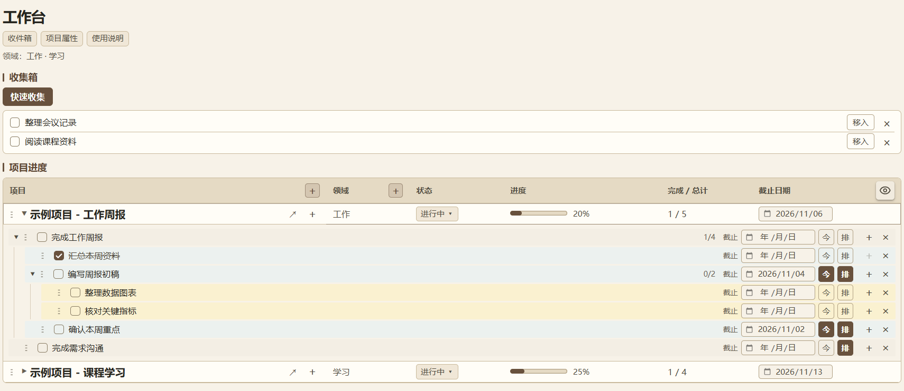
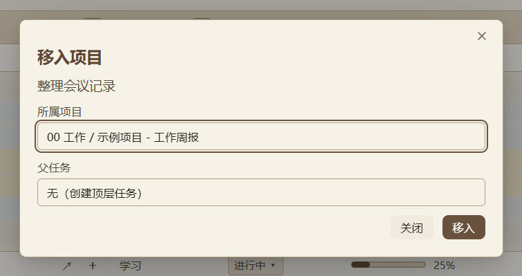
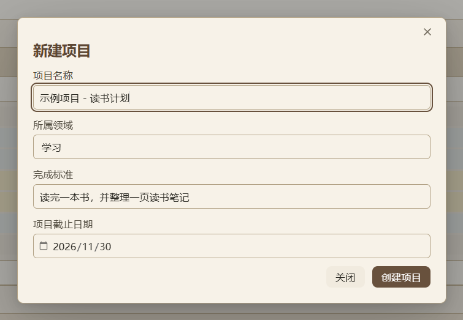
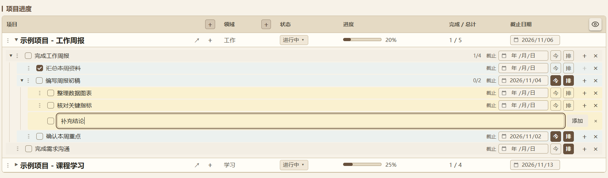
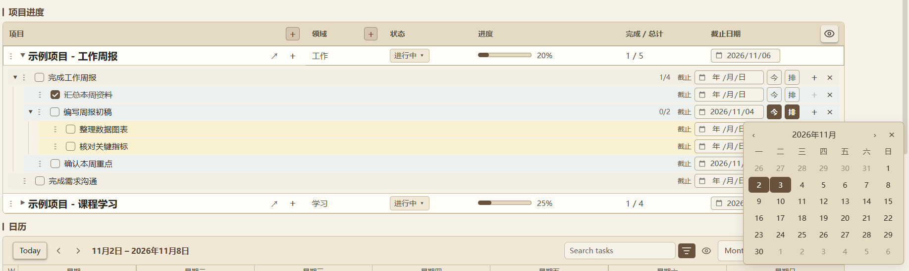
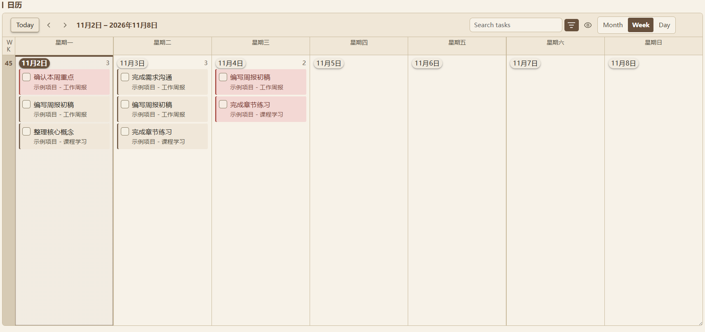
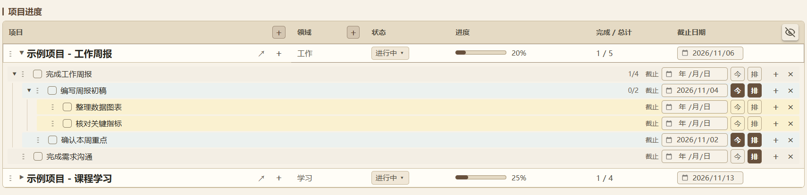

# 安装与使用

项目、多层任务、收集箱和日／周／月日历集中在一个首页。名称可以行内修改，任务可以安排到多天，项目支持完成、恢复和归档。

**已包含全部 4 个必需插件、可选的 WebDAV 同步插件和 CSS，不需要逐个下载。** 安装 Obsidian 后，按下面的步骤打开即可。

更新日期：2026-11-02（北京时间） · 工作台版本：1.10.2 · 图文教程更新：2026-11-02



**配图全部使用专门制作的通用演示案例**，包括工作周报、课程学习和读书计划。截图于 2026-11-02 从独立演示库的 1.10.2 版本重新截取，任务与日期用于说明操作。

日常使用顺序：**快速收集 → 移入项目 → 拆分任务 → 今／排安排日期 → 日历查看 → 勾选完成**。

- [第一次打开](#1-第一次打开)
- [图解操作教程](#3-图解操作教程)
- [合并到已有库](#5-合并到已有库)
- [显示与功能检查](#6-显示与功能检查)


## 1. 第一次打开

1. 安装 **Obsidian 1.13.1 或更高版本**：[官方下载](https://obsidian.md/download)。本包使用的 Tasks 8.6.0 要求至少 1.13.1；打包环境为 Obsidian 1.14.5。
2. 在本仓库页面点击 **Code → Download ZIP** 并完整解压；也可以使用 Git 克隆仓库。找到同时包含 **`README.md`、`00 GTD` 和 `.obsidian`** 的那层文件夹，例如 `Obsidian_GTD_System-main`。使用单独的分享 ZIP 时，这层文件夹叫 `Obsidian-GTD工作台`。
3. 在 Obsidian 的管理库界面选择 **“打开文件夹为仓库 / Open folder as vault”**，打开上一步的文件夹。不要只打开里面的 `00 GTD` 子文件夹。
4. 首次打开若出现信任或受限模式提示，允许此库使用社区插件。在 **设置 → 第三方插件** 确认 Dataview、Tasks、Tasks Calendar、GTD 快捷操作已启用；Remotely Save 按需启用。
5. 在左侧文件列表打开 **`00 GTD/首页.md`**，使用**阅读模式**或**实时预览**。出现上图中的项目表格和按钮后，就可以开始使用；若只看到代码块，按[显示与功能检查](#6-显示与功能检查)逐项核对。

`.obsidian` 是配置文件夹；部分系统会隐藏它，复制或同步时需一并带上。

## 2. 所需插件

| 插件 | 包内版本 | 用途 | 获取方式 |
| --- | --- | --- | --- |
| [Dataview](https://github.com/blacksmithgu/obsidian-dataview) | 0.5.68 | 项目列表、任务树和进度显示 | 已包含 |
| [Tasks](https://github.com/obsidian-tasks-group/obsidian-tasks) | 8.6.0 | 任务勾选、日期、重复任务和编辑器 | 已包含 |
| [Tasks Calendar](https://github.com/eero-lehtinen/obsidian-tasks-calendar) | 1.5.4 · 工作台适配版 | 日、周、月日历和任务卡片 | 已包含，无需另外安装 BRAT |
| GTD 快捷操作 | 1.10.2 · 本地配套插件 | 键盘导航、局部同步、收集、多层任务、日期安排、Ctrl+Z 撤销、项目归档 | 已包含，不在插件商店中搜索 |
| [Remotely Save](https://github.com/remotely-save/remotely-save) | 0.3.25 · 可选 | WebDAV 同步 | 仅包含运行文件，默认未启用 |

项目属性页面使用 Obsidian **核心插件 Bases**，本包已启用。模板文件使用核心插件 Templates；首页的新建项目按钮不依赖额外模板插件。

不需要 QuickAdd、Buttons、Meta Bind、Templater、Kanban 或每日笔记插件。

### WebDAV 同步

本包额外附带 Remotely Save。**未包含它的 `data.json`、服务器地址、用户名、密码、令牌或同步历史。**

需要同步时，在第三方插件中启用 Remotely Save，选择 WebDAV，填写**自己的**服务器地址、账号、密码和远程目录，检查连接后再同步。不需要同步时，保持该插件关闭即可；工作台功能不受影响。

## 3. 图解操作教程

### 3.1 先收集，再移入项目

1. 在首页的收集箱区域点 **“快速收集”**，输入“整理会议记录”等事项并提交。可以连续收集，最后关闭窗口。
2. 事项会出现在首页收集箱。准备归类时，点这一行右侧的 **“移入”**。
3. 选择**所属项目**；父任务选“无”时作为顶层任务，选一个未完成的父任务时作为其子任务。
4. 点 **“移入”**，事项连同子任务和缩进说明一起进入项目，收集箱中的原项会移除。



首页收集箱只显示待整理的未完成事项。行尾 **“×”** 用于删除该收集项；勾选则保留源笔记中的完成记录。

### 3.2 新建项目与领域

首页“项目进度”的几个加号各有用途：

| 按钮位置 | 用途 |
| --- | --- |
| **“项目”表头的“＋”** | 新建项目 |
| **“领域”表头的“＋”** | 新建领域，例如工作、学习、生活 |
| **某个项目行右侧的“＋”** | 给这个项目添加顶层任务 |
| **某项任务行右侧的“＋”** | 给这项任务添加子任务 |

例如新建“示例项目 - 读书计划”，选择“学习”领域，写下完成标准，再按需填写项目截止日期。



**项目截止日期表示整个项目的期限。**需要让具体任务出现在日历中，继续使用任务行上的“今／排／截止”设置。

### 3.3 在首页连续拆分多层任务

展开项目，点击“编写周报初稿”这一行右侧的 **“＋”**，下面就会出现与子任务层级对齐的输入框。



- 输入“补充结论”并按 **Enter**，任务立即加入；输入框保留，可以接着添加“检查格式”等同级子任务。
- 子任务也有“＋”，可以继续向下拆解。缩进、浅色底和左侧箭头帮助区分层级。
- 点击框外会暂存草稿并收起；再点同一个“＋”可以继续输入。
- 输入框旁的 **“×”** 或 **Esc**：关闭输入框并清空未提交草稿。
- 已保存任务行尾的 **“×”**：删除该任务及其子任务，删除后可在提示中撤销。

点击任务名或项目名可以行内改名：**Enter 或点到别处保存，Esc 取消**。拖动左侧点状手柄可调整同级任务、项目的顺序；点“↗”打开对应项目笔记。

点项目或任务行空白处后，可用 **↑↓ 选择、Enter 展开／折叠、空格改名、=／+ 添加**；项目行添加顶层任务，任务行添加子任务，光标自动进入输入框。任务行用 **T 加入／取消今天，Delete 删除任务及其子任务**，删除可用 Ctrl+Z 撤销。左右键进入子项或返回上层，Home／End 跳到首尾可见行。输入框内保留文字编辑按键，Enter 保存或添加。

项目区使用局部同步，更新变化的行并保留其余节点，输入法、草稿、折叠状态和键盘焦点保留。连续添加复用同一输入框，Enter 保存后清空并留住光标；涉及正在输入或点击的控件时，相关结构调整会延后到操作结束。

退出输入后，按 **Ctrl+Z**（Mac 为 **⌘Z**）可撤销最近一次已保存操作，包括任务添加、完成、删除、改名、日期、排序、收集箱移入及项目改名／完成／归档。支持连续撤销当前插件会话最近 30 次；输入框内仍撤销文字。新建项目或领域会清空此前记录，重启或重新加载插件也会清空。若相关笔记已有后续修改，会停止撤销并保留当前内容。

### 3.4 用“今／排／截止”安排任务

| 控件 | 什么时候用 | 操作结果 |
| --- | --- | --- |
| **今** | 今天准备推进 | 加入今天；当天再次点击可移出今天 |
| **排** | 需要在一天或多天推进 | 在弹出的日历中选择多个日期，重复点击可取消；点日期即保存 |
| **截止** | 有明确的最晚完成期限 | 设置或清空这一个任务的截止日期 |

下图把“编写周报初稿”安排在 **11 月 2 日、3 日**，并把截止日期设为 **11 月 4 日**。



同一任务安排到多天，仍然只有一条源任务。在任意一天的卡片或任务树里勾选，其他位置会同步更新，项目进度只计一次。

### 3.5 在日／周／月日历里查看安排

在首页下方的日历中，使用右上角 **Month／Week／Day** 切换月、周、日；**Today** 回到今天，左右箭头切换时间范围。



图中的例子：

- “编写周报初稿”同时出现在 **11 月 2 日和 3 日**，两天都可以推进。
- “确认本周重点”的截止日是 **11 月 2 日**，所以当天卡片为红底。
- “完成章节练习”安排在 **11 月 3 日、4 日**，截止日是 **11 月 4 日**：前一天是普通底色，截止当天才是红底。

**只有任务截止当天的卡片显示红底。**没有安排日期、也没有任务截止日期的事项，可以在收集箱或项目任务树里查看。

### 3.6 完成任务、隐藏已完成与归档

勾选任务前的复选框即可完成，进度条随末级任务的完成情况更新。父任务和子任务分别勾选，完成父任务不会批量完成其子任务。

**已完成任务默认显示。**项目表格右上角的眼睛可统一隐藏或显示本页项目里的已完成分支。下图隐藏了“汇总本周资料”，项目进度仍是 **20%（1／5）**。



| 眼睛所在位置 | 控制范围 |
| --- | --- |
| **项目表格右上角** | 项目任务树中的已完成任务 |
| **日历工具栏** | 日历中的已完成卡片 |

两处分别控制。隐藏仅改变显示，任务仍保留在原笔记中；重新显示后，可以取消勾选恢复未完成状态。带未完成子任务的父任务会继续显示。

整个项目结束后，点项目状态旁的 **“▾”**：

- **完成项目**：从首页项目列表移出，可在项目总览恢复。
- **归档项目**：保留项目笔记、任务和记录，并从首页日历中排除。

项目完成和任务完成分别记录：仅完成项目，已有任务安排仍保留在日历中。

详细操作见库内 [`00 GTD/使用说明.md`](../00%20GTD/使用说明.md)。熟悉后，可以归档自带示例，再建立自己的项目。

## 4. 文件结构

```text
Obsidian-GTD工作台/
├─ README.md
├─ THIRD-PARTY-NOTICES.md
├─ PACKAGE-MANIFEST.json
├─ docs/images/        README 的通用演示配图
├─ 00 GTD/
│  ├─ 首页.md
│  ├─ 使用说明.md
│  └─ 00 工作区/
│     ├─ 00 功能页面/   收件箱、项目属性、项目总览
│     ├─ 01 项目/       工作、学习示例项目
│     ├─ 02 领域/       工作、学习领域
│     ├─ 04 模板/       项目模板
│     ├─ 05 系统视图/   导航和项目进度脚本
│     └─ 99 归档/
├─ .obsidian/
│  ├─ plugins/         四个必需插件及可选 WebDAV 插件；WebDAV 不含设置
│  └─ snippets/        gtd-dashboard.css
└─ 维护资料/            配套插件源码、检查与构建脚本
```

分享内容已替换为全新的通用示例，配置也重新生成，不含原库的个人项目、收件箱记录、归档和窗口历史。

## 5. 合并到已有库

推荐先作为独立库体验。需要合并时：

1. 将整个 `00 GTD` 文件夹复制到目标库根目录，保留内部目录名称。
2. 将 `.obsidian/plugins/` 中四个必需插件放进目标库同一路径；Remotely Save 按需复制，本包未附带它的设置文件。
3. **已有同名插件时，保留原来的 `data.json`，只更新 `main.js`、`manifest.json`、`styles.css`**，然后按下一节核对设置。
4. 复制 `.obsidian/snippets/gtd-dashboard.css`，在 **设置 → 外观 → CSS 代码片段** 启用 `gtd-dashboard`。
5. 复制完成后重启 Obsidian，再启用四个必需插件、Dataview JavaScript 查询及核心插件 Bases，在“文件与链接”中启用自动更新内部链接，打开首页。WebDAV 使用者另行配置自己的同步账户。

合并时保留目标库自己的 `app.json`、`appearance.json`、`workspace.json` 等全局设置；无需用本包文件覆盖。目标库若已有 `00 GTD`，先在独立库中确认如何合并内容。

工作台内部使用固定目录 `00 GTD/00 工作区/...`。项目名称可在首页修改；这些系统目录不随项目改名，不要直接改动目录编号或名称。

## 6. 显示与功能检查

| 情况 | 检查方法 |
| --- | --- |
| 首页只有代码块 | 切到阅读模式或实时预览；启用四个插件，并在 Dataview 设置开启 **Enable JavaScript Queries** |
| 项目属性页打不开 | 在核心插件中启用 **Bases**，并确认 Obsidian 版本达到要求 |
| 样式没有生效 | 外观 → CSS 代码片段 → 启用 `gtd-dashboard`；样式只作用于 `00 GTD` 内容，侧边栏保持原主题 |
| 任务不在日历里 | 给任务点“今／排”或设置任务截止日期，再翻到对应日期；项目截止日期不是任务日期 |
| 已完成任务不显示 | 项目进度和日历分别用各自的眼睛按钮切换；本包两处默认都显示 |
| Tasks 识别不到普通任务 | 合并到旧库时，检查 Tasks 的全局任务过滤条件；此工作台使用不带专用过滤标签的任务 |
| 日历中新任务保存到了别处 | Tasks Calendar 的 **New task file** 设为 `00 GTD/00 工作区/00 功能页面/收件箱.md` |
| 名称修改失败 | 查看输入框下的原因；修正重名或格式问题后重试，或先复制草稿再取消并重新编辑 |

移动设备需要同步整个库及 `.obsidian`，再启用同样的插件和 CSS。包内插件均标记为支持移动端；本包主要在桌面环境验证，手机触屏操作尚未实机测试。

## 7. 更新与维护

**保留随包附带的 Tasks Calendar 适配版。**截止日红底依赖日历卡片上的配套标记；直接换回上游原版后，需要重新应用适配。`维护资料` 中提供 1.5.4 版本的适配脚本和说明。

GTD 快捷操作已经编译好，普通使用无需 Python、Node.js 或构建步骤。源码和构建脚本仅供后续维护。

## 8. 来源与授权

第三方插件的原始许可证随插件目录保留，版本、来源和本地改动见 [THIRD-PARTY-NOTICES.md](../THIRD-PARTY-NOTICES.md)。继续转发时一并保留这些文件。

本包不包含 Obsidian 安装程序，Obsidian 请从官方下载安装。
