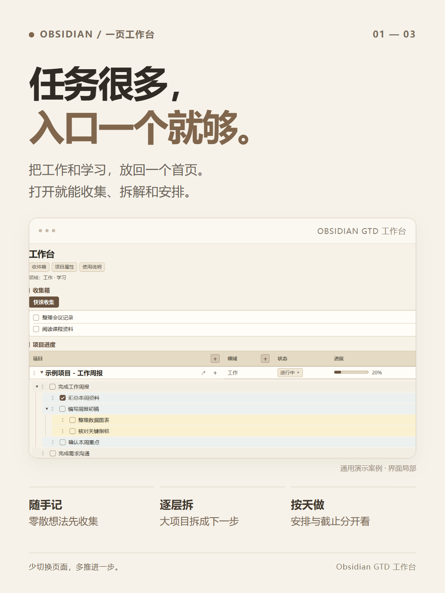
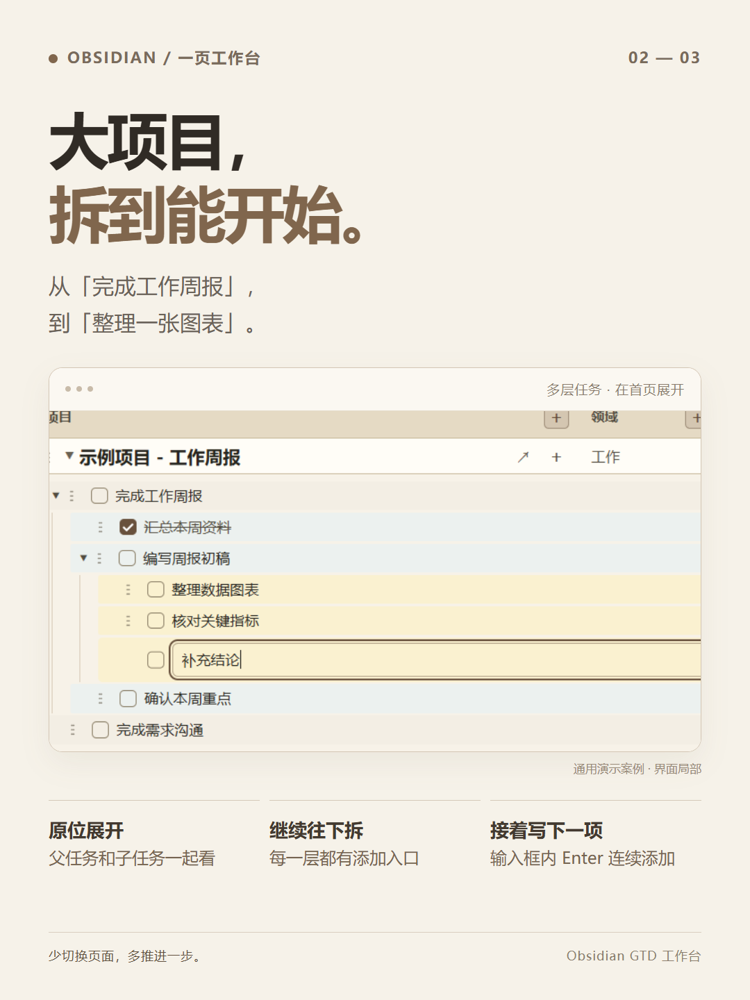
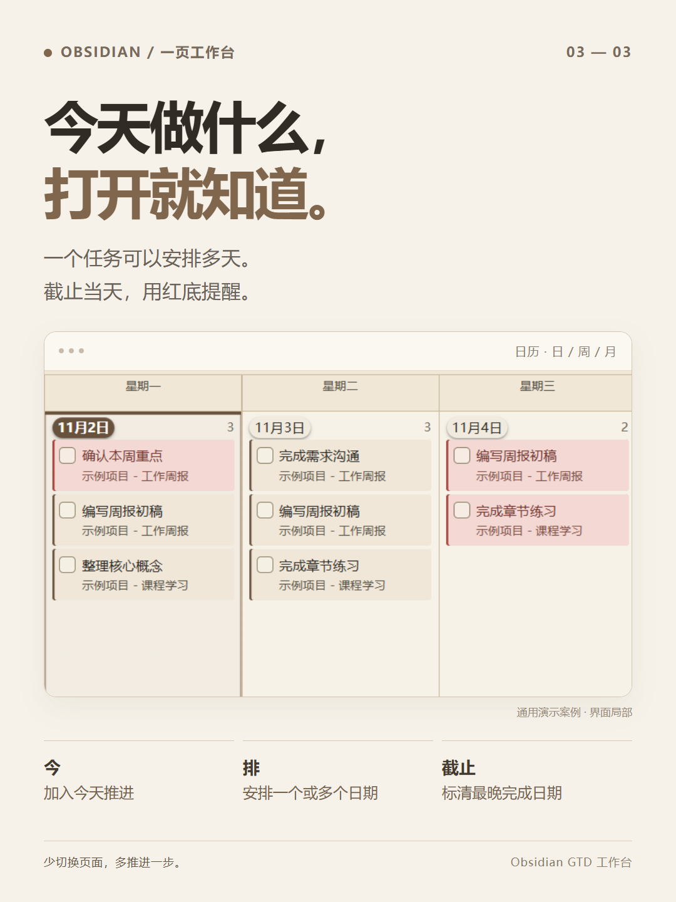

# 待办很多，我只想打开一个首页

待办写了一堆，今天还是不知道先做什么？

项目建好了，却一直停在一个大标题？

一个任务要做几天，每天都要再记一遍？

所以，我把常用的操作放进了 Obsidian 的一个首页。

📥 想到什么先收集，理清后再移入项目。

🧩 大任务逐层拆开，直到看到能开始的下一步。

🗓️ 今天想做的点「今」，需要做几天的点「排」，真正的期限单独设「截止」。

收集箱、项目进度和日历，都在这一页。

任务能直接添加、改名、勾选；做完太多，就用眼睛按钮暂时收起。误操作也可以 Ctrl+Z 撤销。

**把精力留给做事。**

整包带有必需插件和 CSS，下载后按说明作为 Obsidian 仓库打开。

项目地址：https://github.com/QiminW/Obsidian_GTD_System

#Obsidian #任务管理 #极简主义 #GTD #学习计划

---

配图按下面的顺序使用，均为 1080 × 1440 的竖图，内容来自通用演示案例：

